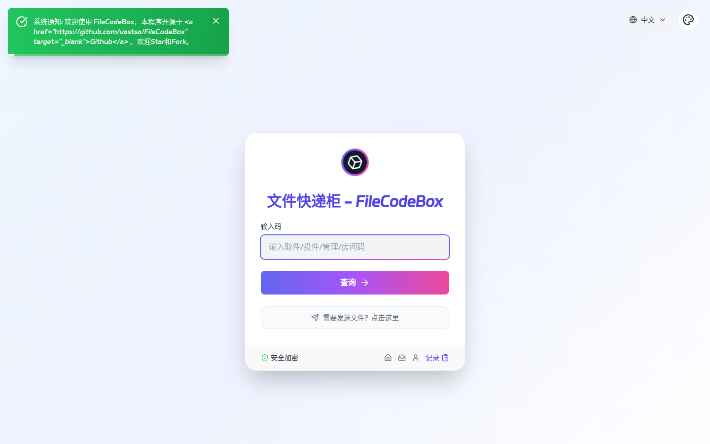
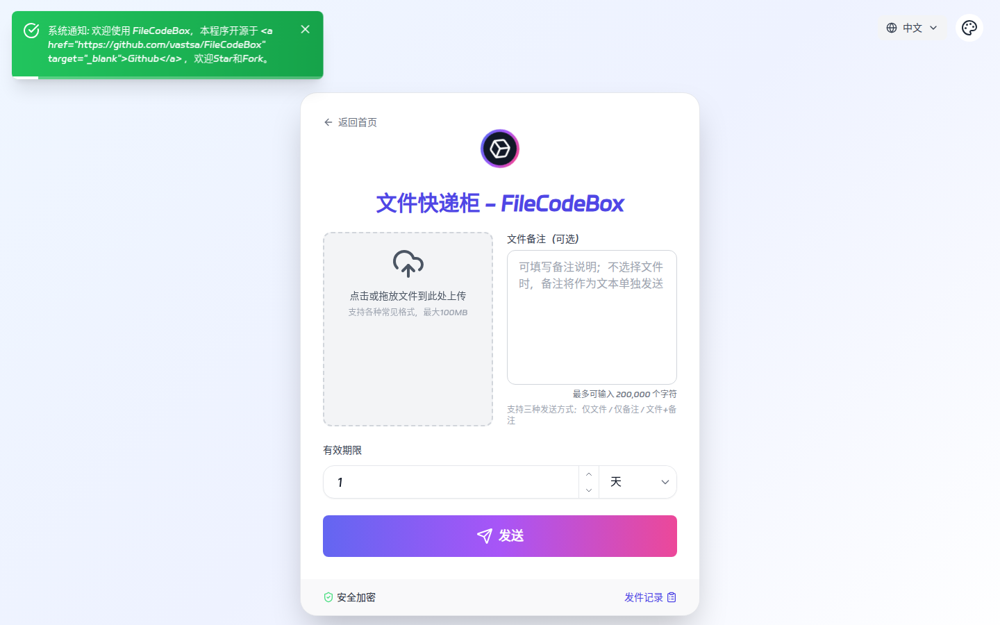
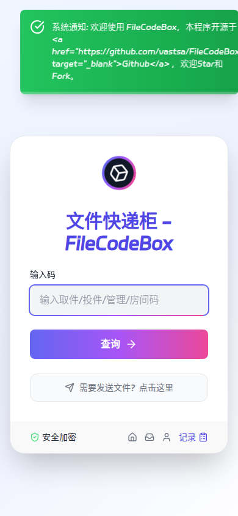
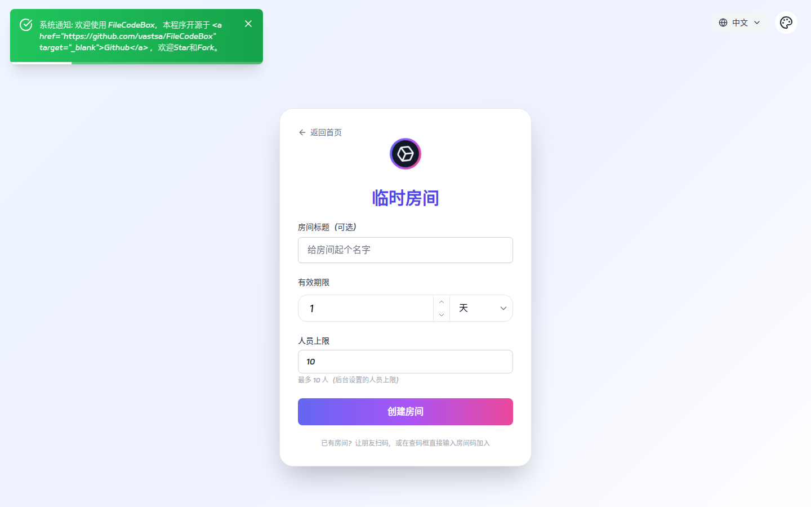
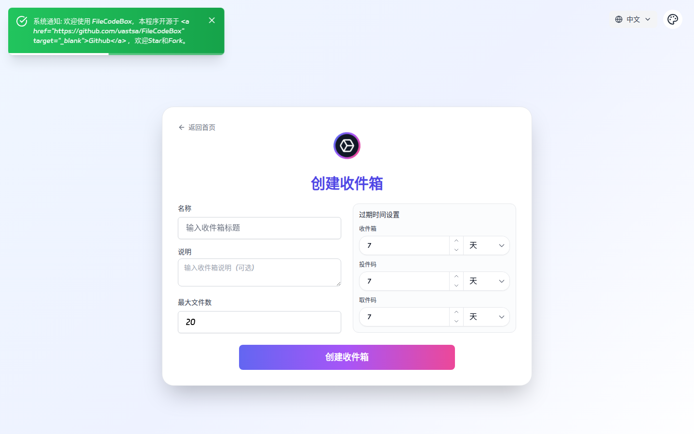
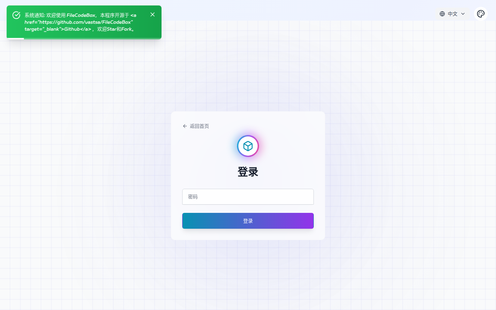

<div align="center">

# FileCodeBox

### 驿码 - 匿名口令分享文本和文件

无需注册，输入口令即可分享与取件

[](https://github.com/onlypeng/FileCodeBox/stargazers)
[](https://github.com/onlypeng/FileCodeBox/network)
[](https://github.com/onlypeng/FileCodeBox/issues)
[](https://github.com/onlypeng/FileCodeBox/blob/master/LICENSE)

[](https://www.python.org)
[](https://fastapi.tiangolo.com)
[](https://vuejs.org)
[](https://webrtc.org)

[English](./readme_en.md)

```bash
# 🚀 一键部署
docker run -d --restart always -p 12345:12345 -v /opt/FileCodeBox:/app/data --name filecodebox lanol/filecodebox:latest
# 国内镜像（如果上面拉取缓慢）: docker.cnb.cool/aixk/filecodebox
```

</div>

---

## 目录

- [项目简介](#-项目简介)
- [功能特性](#-功能特性)
- [界面预览](#-界面预览)
- [快速开始](#-快速开始)
- [使用指南](#-使用指南)
- [命令行使用（curl）](#-命令行使用curl)
- [API 概览](#-api-概览)
- [管理后台](#-管理后台)
- [系统配置说明](#-系统配置说明)
- [开发指南](#-开发指南)
- [常见问题](#-常见问题)
- [免责声明](#-免责声明)

---

## 📝 项目简介

FileCodeBox 是一个轻量级的文件分享工具，基于 **FastAPI + Vue3** 开发。用户无需注册，输入口令（提取码）即可匿名分享与获取文本和文件——就像从驿站取件一样简单。

除了基础的文本/文件分享，当前版本还内置了 **收件箱（文件收集）**、**跨设备聊天**、**直连快传（WebRTC P2P + 服务器中转）** 等模块，可覆盖临时分享、文件收集、多人协作、跨设备同步、多摄像头实时共享等多种场景。

### 应用场景

| 场景 | 描述 |
|------|------|
| 📁 **临时文件分享** | 快速分享文件，无需注册登录 |
| 📝 **代码片段分享** | 分享代码、配置文件等文本内容 |
| 🕶️ **匿名文件传输** | 保护隐私的点对点传输 |
| 📬 **文件收集** | 创建收件箱，他人凭投件码上传文件，收件人统一管理 |
| 💬 **跨设备聊天** | 通过房间码实时收发消息 |
| ⚡ **直连快传** | WebRTC P2P 直传大文件；支持多人房间、消息+文件一体、多摄像头画面共享，服务器中转兜底且不落盘 |
| 💾 **临时存储** | 支持自定义过期时间（时间/次数）的云存储 |
| 🌐 **私有服务** | 搭建企业或个人专属分享服务 |

---

## ✨ 功能特性

<table>
<tr>
<td width="33%" valign="top">

### 🚀 轻量高效
- FastAPI + SQLite3 后端
- Vue3 + TypeScript + Vite 前端（构建产物直接由后端内置服务，单端口部署）
- Docker 一键部署
- 资源占用极低

</td>
<td width="33%" valign="top">

### 🔒 安全可靠
- IP 上传/查询频率限制
- 提取码错误次数限制
- 文件自动过期清理
- 管理员口令 PBKDF2 哈希存储
- 敏感配置（S3/WebDAV 凭据）加密存储

</td>
<td width="33%" valign="top">

### 📤 便捷上传
- 拖拽 / 复制粘贴上传
- 多文件批量上传
- 分片上传（断点续传，SHA256 校验；分片大小后台可配置）
- S3 预签名直传（其他存储自动走代理转存）

</td>
</tr>
<tr>
<td width="33%" valign="top">

### 🎫 灵活分享
- 随机/自定义提取码
- 有效期：天 / 小时 / 分钟 / 下载次数 / 永久
- 支持备注（remark）
- 多文件打包 ZIP 下载

</td>
<td width="33%" valign="top">

### 📬 收件箱（文件收集）
- 三码分离：管理码 / 投件码 / 取件码
- 可设密码、最大文件数、投递次数
- 管理码、投件码、取件码独立过期
- WebSocket 实时推送投递进度

</td>
<td width="33%" valign="top">

### ⚡ 直连快传（WebRTC）
- 跨设备实时聊天（房间码加入）
- 多人房间：消息 + 文件一体，文件定向转发
- **多摄像头实时共享**：多路摄像头同一窗口网格分割显示（类监视器大屏）
- WebRTC P2P 优先，服务器中转兜底（不落盘、可控分片大小与限速）

</td>
</tr>
<tr>
<td width="33%" valign="top">

### 💾 多存储支持
- 本地文件系统
- S3 兼容存储
- OneDrive
- OpenDAL
- WebDAV

</td>
<td width="33%" valign="top">

### 🛠 管理后台
- 仪表盘（分享/收件箱/投递统计）
- 文件管理（含多文件明细）
- 收件箱管理
- 直连快传房间管理
- 系统配置在线修改（热加载）

</td>
<td width="33%" valign="top">

### 🌍 国际化与设备适配
- 简体中文 / English
- 响应式设计 / 深色模式
- 手机 / 平板 / 电脑自适应（UA + 触屏识别）
- 反代环境支持（CORS 白名单、可信代理配置）

</td>
</tr>
</table>

---

## 🖼️ 界面预览

> 以下截图由本项目实际运行页面截取（前端仓库：[FileCodeBoxFronted](https://github.com/onlypeng/FileCodeBoxFronted)）。

<details open>
<summary><b>🎨 首页与发件</b></summary>
<br>
<div align="center">
<table>
<tr>
<td></td>
<td></td>
</tr>
<tr>
<td></td>
<td></td>
</tr>
<tr>
<td></td>
<td></td>
</tr>
</table>
</div>
</details>

---

## 🚀 快速开始

### Docker 部署（推荐）

**方式一：Docker CLI**

```bash
# Docker Hub（推荐）
docker run -d --restart always -p 12345:12345 -v /opt/FileCodeBox:/app/data --name filecodebox lanol/filecodebox:latest

# 国内镜像（如果 Docker Hub 拉取缓慢）
docker run -d --restart always -p 12345:12345 -v /opt/FileCodeBox:/app/data --name filecodebox docker.cnb.cool/aixk/filecodebox
```

**方式二：Docker Compose**

```yaml
services:
  file-code-box:
    image: lanol/filecodebox:latest
    container_name: filecodebox
    restart: unless-stopped
    ports:
      - "12345:12345"
    volumes:
      - ./data:/app/data
    environment:
      - WORKERS=4
      - LOG_LEVEL=info
      - JWT_SECRET=your-random-secret
      - ENCRYPTION_KEY=your-encryption-key
```

```bash
docker compose up -d
```

### 环境变量说明

| 变量 | 默认值 | 说明 |
|------|--------|------|
| `HOST` | `0.0.0.0` | 监听地址 |
| `PORT` | `12345` | 服务端口 |
| `WORKERS` | `1` | 工作进程数（建议设为 CPU 核心数） |
| `LOG_LEVEL` | `info` | 日志级别：`debug` / `info` / `warning` / `error` |
| `JWT_SECRET` | 空 | JWT 签名密钥。设置后修改管理员密码不会使已登录 Token 失效；留空则回退到管理员口令派生 |
| `ENCRYPTION_KEY` | 空 | 敏感配置（S3/WebDAV 等凭据）的加密密钥，**强烈建议生产环境配置**；留空则从管理员口令派生 |

### 反向代理配置

使用 Nginx 时，请添加以下配置以正确获取客户端 IP（否则 IP 限流可能失效）：

```nginx
location / {
    proxy_pass http://127.0.0.1:12345;
    proxy_set_header Host $host;
    proxy_set_header X-Real-IP $remote_addr;
    proxy_set_header X-Forwarded-For $proxy_add_x_forwarded_for;
    proxy_set_header X-Forwarded-Proto $scheme;
    client_max_body_size 100m;  # 根据需要调整上传大小限制
    # WebSocket（收件箱实时推送 / 聊天 / 直连快传）
    proxy_http_version 1.1;
    proxy_set_header Upgrade $http_upgrade;
    proxy_set_header Connection "upgrade";
}
```

> 注意：容器启动时默认仅信任回环地址的转发头（`--forwarded-allow-ips "127.0.0.1"`）。部署在反向代理之后时，需将代理地址加入白名单，并在后台配置 `trustedProxies`。

### 手动部署（前后端一体）

```bash
# 1. 克隆项目
git clone https://github.com/onlypeng/FileCodeBox.git
cd FileCodeBox

# 2. 安装依赖
pip install -r requirements.txt

# 3. 构建前端并放入 frontend_dist（可选，仓库已内置当前构建产物）
# cd FileCodeBoxFronted && npm install && npm run build
# cp -r dist/* ../FileCodeBox/frontend_dist/

# 4. 启动服务（默认单端口 serve 前端构建产物 + 后端 API）
python main.py
```

> 后端启动时会自动检测 `frontend_dist/` 目录，存在则优先用它 serve 前端页面与静态资源（`/assets`），缺失时回退到 `themes/` 主题模板。

---

## 📖 使用指南

### 基础操作

| 操作 | 步骤 |
|------|------|
| **分享文件/文本** | 打开网页 → 选择「发件」→ 拖拽/粘贴/输入 → 设置有效期 → 获取提取码 |
| **获取文件** | 首页「查码」→ 输入提取码 → 查看/下载 |
| **创建收件箱** | 首页 → 创建收件箱 → 设置标题/密码/容量/有效期 → 获得管理码、投件码、取件码 |
| **投递文件** | 进入投递页（投件码）→ 上传文件（可署名）→ 投递 |
| **收件箱管理** | 输入管理码 → 查看/下载/打包/删除投递的文件 |
| **取件** | 输入取件码 → 只读查看并下载文件 |
| **直连快传** | 首页 → 直连快传 → 创建房间 → 分享房间码 → 聊天 / 传文件 / 共享摄像头 |
| **管理后台** | 访问 `/#/admin` → 输入管理员口令登录 |

### 发件

- 支持文本与文件两种类型，文本单次不超过 222KB。
- 支持单文件、多文件（默认最多 20 个）批量分享；多文件分享可打包 ZIP 下载，也可单独下载某一文件。
- 有效期支持 `天 / 小时 / 分钟 / 下载次数 / 永久`（具体以后台 `expireStyle` 配置为准），并可附加备注。
- 分片上传启用后，大文件按后台配置的 `uploadChunkSize`（默认 5MB）分片上传，支持断点续传与 SHA256 校验。

### 收件箱（文件收集）

创建收件箱后会生成三个独立口令：

| 码 | 用途 | 权限 |
|------|------|------|
| **管理码** `collection_code` | 收件人管理收件箱 | 查看、下载、打包、删除文件、修改配置 |
| **投件码** `delivery_code` | 投件人上传文件 | 仅上传；可设置投递次数上限 |
| **取件码** `retrieve_code` | 取件人查看 | 只读查看与下载，不可删除 |

收件箱可设置：标题、描述、密码、最大文件数、投件码/取件码独立有效期、投递次数上限。投递进度通过 WebSocket 实时推送到管理页面。

### 直连快传（WebRTC）

- **多人房间**：创建房间获得房间码，实时收发文本消息，支持历史消息同步与在线成员展示。
- **直连传输**：发送文件前需接收方确认，文件定向转发给目标用户；优先 WebRTC P2P，对称 NAT 等无法直连时自动回退服务器中转（不落盘）。
- **多摄像头共享**：桌面端可同时选择多个摄像头共享（同一窗口网格分割显示，类监视器大屏）；手机/平板支持在设备间单选切换；竖屏画面保持原比例不裁切。
- 可通过后台配置 TURN 服务器（`directTurnServers`）提升 P2P 直连成功率；中转分片大小（`directRelayChunkSize`）、单次中转文件上限（`directMaxRelaySize`）、中转限速（`directRelaySpeedLimit`）均可后台配置。

---

## 🧪 命令行使用（curl）

<details>
<summary><b>点击展开 curl 使用示例</b></summary>

**上传文件**

```bash
# 基础上传（默认 1 天有效期）
curl -X POST "http://localhost:12345/share/file/" \
  -F "file=@/path/to/file.txt"

# 指定 1 小时有效期
curl -X POST "http://localhost:12345/share/file/" \
  -F "file=@/path/to/file.txt" \
  -F "expire_value=1" \
  -F "expire_style=hour"

# 指定下载 10 次后过期
curl -X POST "http://localhost:12345/share/file/" \
  -F "file=@/path/to/file.txt" \
  -F "expire_value=10" \
  -F "expire_style=count"

# 多文件批量上传
curl -X POST "http://localhost:12345/share/file/" \
  -F "files=@a.txt" \
  -F "files=@b.txt" \
  -F "remark=批量文件"
```

**分享文本**

```bash
curl -X POST "http://localhost:12345/share/text/" \
  -F "text=要分享的文本内容"
```

**取件查询**

```bash
curl "http://localhost:12345/share/select/?code=提取码"
```

**下载文件**（先取件获取带签名 key 的下载地址，再跟随重定向下载）

```bash
curl -L "http://localhost:12345/share/download?key=<key>&code=提取码" -o filename
```

**检查码类型**（自动识别 文件码 / 管理码 / 投件码 / 取件码 / 聊天房间码 / 直连房间码）

```bash
curl "http://localhost:12345/share/check_code/?code=提取码"
```

**有效期参数**

| `expire_style` | 说明 |
|----------------|------|
| `day` | 天数 |
| `hour` | 小时 |
| `minute` | 分钟 |
| `count` | 下载次数 |
| `forever` | 永久有效 |

**返回示例**

```json
{
  "code": 200,
  "message": "ok",
  "detail": {
    "code": "ABCD12",
    "name": "file.txt"
  }
}
```

**需要认证时**（管理员关闭游客上传后，`openUpload=0`）

```bash
# 1. 获取 token
curl -X POST "http://localhost:12345/admin/login" \
  -H "Content-Type: application/json" \
  -d '{"password": "FileCodeBox2023"}'

# 2. 携带 token 上传
curl -X POST "http://localhost:12345/share/file/" \
  -H "Authorization: Bearer <token>" \
  -F "file=@/path/to/file.txt"
```

</details>

---

## 📚 API 概览

> 完整接口定义见 [docs/api](./docs/api/index.md)。以下为常用接口速查。所有业务响应统一为 `{ "code": 200, "message": "ok", "detail": {...} }`。

### 分享接口 `/share`

| 方法 | 路径 | 说明 |
|------|------|------|
| POST | `/share/text/` | 分享文本 |
| POST | `/share/file/` | 分享文件（单/多文件） |
| GET | `/share/check_code/` | 检查码类型 |
| GET/POST | `/share/select/` | 取件（获取文件信息/下载地址） |
| GET | `/share/download` | 下载文件（需签名 key） |
| GET | `/share/download/item/{item_id}` | 下载多文件分享中的单个文件 |
| GET | `/share/zip/{code}` | 打包 ZIP 下载 |

### 分片上传 `/chunk`

| 方法 | 路径 | 说明 |
|------|------|------|
| POST | `/chunk/upload/init/` | 初始化分片会话（断点续传检测） |
| POST | `/chunk/upload/chunk/{upload_id}/{index}` | 上传单个分片 |
| GET | `/chunk/upload/status/{upload_id}` | 查询上传进度 |
| POST | `/chunk/upload/complete/{upload_id}` | 合并分片并生成分享码 |
| DELETE | `/chunk/upload/{upload_id}` | 取消上传 |

### 预签名上传 `/presign`

| 方法 | 路径 | 说明 |
|------|------|------|
| POST | `/presign/upload/init` | 初始化（S3 返回直传 URL，其他存储返回代理 URL） |
| PUT | `/presign/upload/proxy/{upload_id}` | 代理模式上传 |
| POST | `/presign/upload/confirm/{upload_id}` | 直传模式确认并生成分享码 |
| GET | `/presign/upload/status/{upload_id}` | 查询会话状态 |
| DELETE | `/presign/upload/{upload_id}` | 取消会话 |

### 收件箱 `/collection` 与投递 `/delivery`

| 方法 | 路径 | 说明 |
|------|------|------|
| POST | `/collection/create/` | 创建收件箱（返回三码） |
| GET | `/collection/manage/{collection_code}` | 管理页面（文件列表） |
| GET | `/collection/retrieve/{retrieve_code}` | 取件页面（只读） |
| GET | `/collection/manage-by-delivery/{delivery_code}` | 投件码查看已投递文件 |
| PATCH | `/collection/update/{collection_code}` | 更新投件码/取件码有效期、最大文件数 |
| GET | `/collection/download/{file_id}` | 下载文件（需管理码/取件码） |
| GET | `/collection/zip/{code}` | 打包下载所有文件 |
| DELETE | `/collection/delete/{file_id}` | 删除文件（仅管理码） |
| GET | `/delivery/{delivery_code}` | 获取投递页信息 |
| POST | `/delivery/upload/` | 投递文件 |
| WS | `/ws/collection/{code}` | 收件箱实时推送（管理码或投件码可连接） |

### 跨设备聊天 `/chat`

| 方法 | 路径 | 说明 |
|------|------|------|
| POST | `/chat/create/` | 创建聊天房间 |
| GET | `/chat/info/{room_code}` | 房间信息 |
| GET | `/chat/history/{room_code}` | 历史消息 |
| WS | `/ws/chat/{room_code}` | 实时聊天 |

### 直连快传 `/direct`

| 方法 | 路径 | 说明 |
|------|------|------|
| POST | `/direct/create/` | 创建直连快传房间 |
| GET | `/direct/info/{room_code}` | 房间信息 |
| GET | `/direct/history/{room_code}` | 历史消息 |
| WS | `/ws/direct/{room_code}` | 多人聊天 + 文件确认与定向中继（WebRTC 信令 + 二进制分片中继） |

### 管理接口 `/admin`

| 方法 | 路径 | 说明 |
|------|------|------|
| POST | `/admin/login` | 管理员登录，返回 Bearer Token |
| GET | `/admin/dashboard` | 仪表盘统计 |
| GET | `/admin/file/list` | 文件列表（分页/搜索） |
| DELETE | `/admin/file/delete` | 删除文件 |
| GET | `/admin/config/get` | 获取系统配置（敏感项脱敏） |
| PATCH | `/admin/config/update` | 更新系统配置 |
| GET | `/admin/collection/list` | 收件箱列表 |
| GET | `/admin/collection/{id}/files` | 收件箱文件列表 |
| DELETE | `/admin/collection/{id}` | 删除收件箱及其文件 |
| GET | `/admin/direct/room/list` | 直连快传房间列表（含在线人数） |
| DELETE | `/admin/direct/room/{id}` | 删除直连快传房间 |

---

## 🛠 管理后台

访问 `/#/admin`（或 `/#/login`），使用管理员口令登录（默认 `FileCodeBox2023`，**首次部署请务必修改**）。

### 仪表盘

- 总文件数 / 存储空间 / 今日分享 / 昨日分享
- 收件箱总数与有效数、投递统计
- 文件健康度、类型分布、最近分享记录

### 文件管理

- 分页浏览所有分享记录（含多文件子项明细），支持按文件名搜索
- 过期文件展示状态，可手动删除

### 收件箱管理

- 查看全部收件箱（标题、三码、容量、各码有效期与过期状态）
- 查看单个收件箱的文件列表，支持删除收件箱及全部文件

### 直连快传房间管理

- 查看房间（在线人数、消息数、过期状态），可强制删除房间并断开在线连接

### 系统配置

- 站点信息（名称、描述、通知、页面说明、robots）
- 存储引擎（本地 / S3 / OneDrive / WebDAV）及凭据
- 上传设置（游客上传开关、单文件大小、分片开关、分片大小、有效期类型、最长保存时间）
- 限流设置（上传频率、错误次数）
- 主题选择、透明度、背景图
- 高级设置（工作进程、CORS 白名单、可信代理、直连中继开关/分片大小/单次上限/限速/TURN 服务器）

---

## ⚙️ 系统配置说明

以下为 `DEFAULT_CONFIG` 中的核心配置项（均可在管理后台修改，写入数据库 `settings` 记录并热加载）：

| 配置项 | 默认值 | 说明 |
|--------|--------|------|
| `file_storage` | `local` | 存储引擎：`local` / `s3` / `onedrive` / `opendal` / `webdav` |
| `admin_token` | `FileCodeBox2023` | 管理员口令（PBKDF2 哈希存储，界面显示脱敏） |
| `openUpload` | `1` | 是否允许游客上传（关闭后需登录） |
| `uploadSize` | `10MB` | 单文件大小上限 |
| `uploadMinute` / `uploadCount` | `1` / `10` | IP 上传限流：每 X 分钟最多 Y 个文件 |
| `errorMinute` / `errorCount` | `1` / `10` | IP 查询错误限流：每 X 分钟最多错误 Y 次 |
| `expireStyle` | 5 种 | 可选有效期类型（天/小时/分钟/次数/永久） |
| `enableChunk` | `0` | 是否启用分片上传 |
| `uploadChunkSize` | `5` | 分片大小（MB），启用分片上传后大文件按此分片 |
| `max_save_seconds` | `0` | 最长保存时间（秒），`0` 为不限制 |
| `maxMultiFileCount` | `20` | 多文件分享单次数量上限 |
| `maxSendFiles` | `20` | 发件时文件数量上限 |
| `maxCollectionFiles` | `100` | 收件箱最大文件数上限 |
| `collectionDefaultMaxFiles` | `20` | 创建收件箱默认最大文件数 |
| `collectionDefaultExpireDays` | `7` | 创建收件箱默认有效期（天） |
| `themesSelect` | `themes/2024` | 主题模板目录（未内置构建产物时使用） |
| `showAdminAddr` | `0` | 是否在前台显示管理入口 |
| `trustedProxies` | 空 | 可信代理 IP（逗号分隔） |
| `cors_origins` | `http://localhost:5173,...` | CORS 白名单（逗号分隔；生产同源部署可留空） |
| `directRelayEnabled` | `1` | 直连快传服务器中转开关 |
| `directRelayChunkSize` | `64` | 服务器中转分片大小（KB，16~256KB） |
| `directMaxRelaySize` | `0` | 单次中转文件大小上限（MB，`0` 不限制） |
| `directRelaySpeedLimit` | `0` | 服务器中转限速（KB/s，`0` 不限速） |
| `directTurnServers` | `[]` | WebRTC TURN 服务器列表（对称 NAT 下 P2P 失败时兜底） |

> 敏感配置项（S3/OneDrive/WebDAV 凭据）保存时使用 `ENCRYPTION_KEY`（或管理员口令派生密钥）加密；读取配置时自动解密，管理界面展示时脱敏。

---

## 🔧 开发指南

### 项目结构

```
FileCodeBox/
├── apps/
│   ├── admin/          # 管理后台（登录、仪表盘、文件/收件箱/直连房间管理、配置）
│   └── base/           # 基础功能（分享、分片、预签名、收件箱、投递、聊天、直连快传）
├── core/               # 核心模块（配置、数据库、存储、任务、WebSocket、工具）
├── data/               # 数据目录（运行时生成，含 SQLite 与上传文件）
├── docs/               # VitePress 文档
├── frontend_dist/      # 前端构建产物（后端优先 serve；可替换为最新构建结果）
├── themes/             # 前端主题模板（构建产物缺失时的回退）
├── main.py             # 入口文件（API + 静态资源服务）
└── requirements.txt    # Python 依赖
```

### 本地开发

**后端**

```bash
pip install -r requirements.txt
python main.py
```

**前端**

```bash
# 前端仓库: https://github.com/onlypeng/FileCodeBoxFronted
cd FileCodeBoxFronted
npm install        # 或 pnpm install
npm run dev
# 构建：产物放入后端 frontend_dist 后由后端单端口 serve
npm run build
cp -r dist/* ../FileCodeBox/frontend_dist/
```

> 前端开发默认访问 `http://localhost:5173`，后端默认已配置该地址为 CORS 白名单。

### 技术栈

| 类别 | 技术 |
|------|------|
| **后端框架** | FastAPI / Uvicorn |
| **数据库** | SQLite + Tortoise ORM |
| **数据验证** | Pydantic 2.x |
| **异步支持** | aiofiles / aiohttp / aioboto3 |
| **对象存储** | S3 协议 / OneDrive / OpenDAL / WebDAV |
| **实时通信** | WebSocket（收件箱推送 / 聊天 / 直连中继）|
| **P2P 传输** | WebRTC（直连快传，多路媒体与数据通道）|
| **媒体共享** | getUserMedia 多摄像头采集 + 网格布局渲染 |
| **前端框架** | Vue 3 + Vite + TypeScript |
| **密码安全** | PBKDF2-SHA256 / Fernet 加密 |
| **容器化** | Docker / Docker Compose |

---

## ❓ 常见问题

<details>
<summary><b>如何修改上传大小限制？</b></summary>

在管理后台 → 系统配置中修改 `uploadSize`。如果使用 Nginx 反向代理，还需修改 `client_max_body_size`。
</details>

<details>
<summary><b>如何配置存储引擎？</b></summary>

在管理后台 → 系统配置中选择存储引擎类型并配置相应参数。支持本地存储、S3、OneDrive、OpenDAL、WebDAV。
</details>

<details>
<summary><b>如何更换前端页面？</b></summary>

分别构建 `FileCodeBoxFronted`（`npm run build`）后将 `dist/*` 复制到后端 `frontend_dist/` 覆盖即可；后端启动时优先读取 `frontend_dist/index.html` 与 `/assets`。
</details>

<details>
<summary><b>如何备份数据？</b></summary>

备份 `data` 目录即可，其中包含数据库和上传的文件。
</details>

<details>
<summary><b>如何修改管理员口令？</b></summary>

登录管理后台后，在系统配置中修改 `admin_token`（留空表示不修改，界面显示脱敏）。新口令会自动以 PBKDF2 哈希存储。
</details>

<details>
<summary><b>部署在反向代理后 IP 限流失效怎么办？</b></summary>

确保反向代理透传 `X-Forwarded-For` 头，并将代理地址加入容器启动白名单（`--forwarded-allow-ips`）及后台 `trustedProxies` 配置。
</details>

<details>
<summary><b>直连快传无法建立 P2P 连接？</b></summary>

对称 NAT 下 P2P 无法直连，会自动回退到服务器中转（不落盘）。可配置 TURN 服务器（`directTurnServers`）提升直连成功率。
</details>

<details>
<summary><b>多摄像头共享/中转传文件很慢或失败？</b></summary>

服务器中转时可调整 `directRelayChunkSize`（分片大小，默认 64KB）与 `directRelaySpeedLimit`（限速）；单次中转文件过大可调 `directMaxRelaySize`（默认不限制）。多摄像头共享同时开流数量受浏览器/设备能力限制，桌面端最多同时共享 4 路。
</details>

---

## 📜 免责声明

本项目开源仅供学习交流使用，不得用于任何违法用途，否则后果自负，与作者无关。使用本项目时请保留项目地址和版权信息。

---

<div align="center">

**如果觉得项目不错，欢迎 ⭐ Star 支持！**

Made with ❤️ by [onlypeng](https://github.com/onlypeng)

</div>