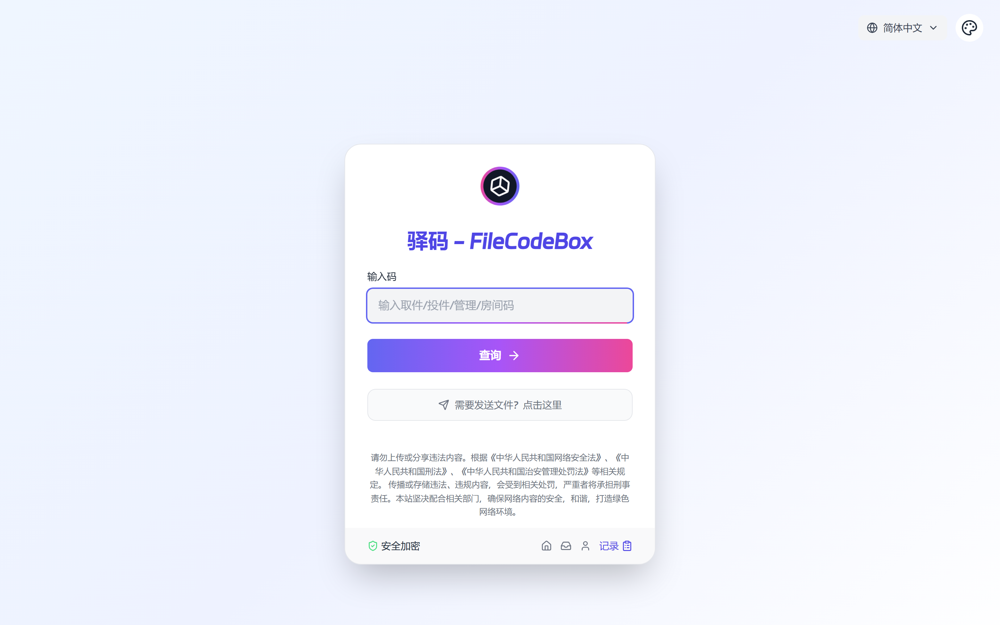
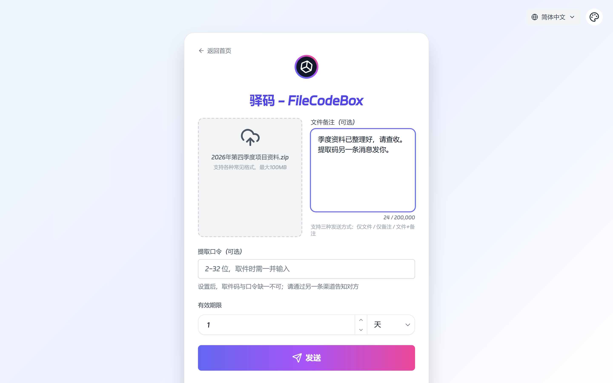
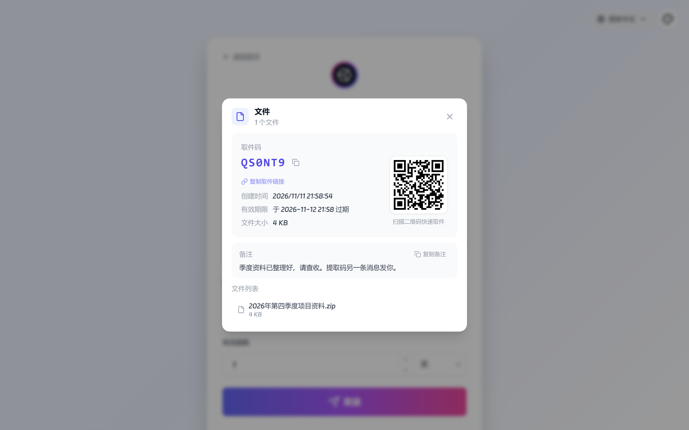
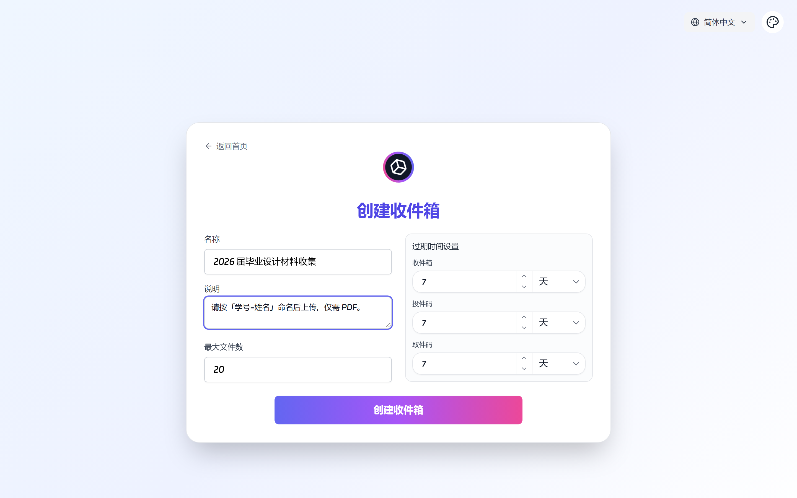
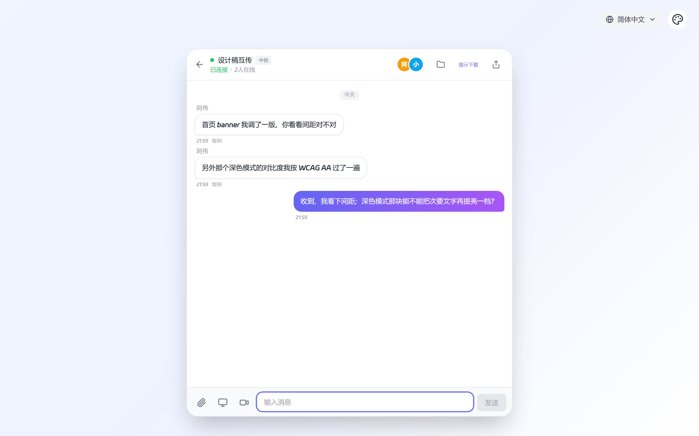
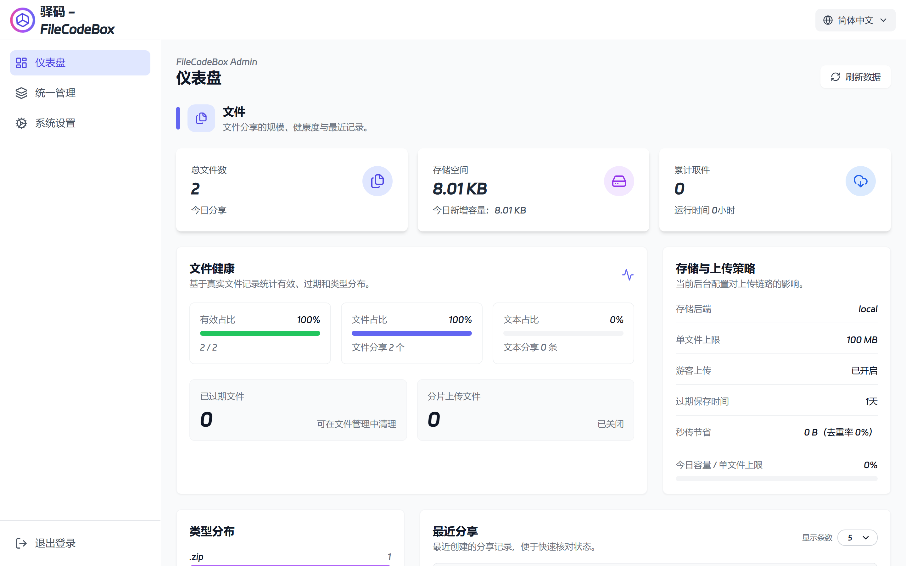
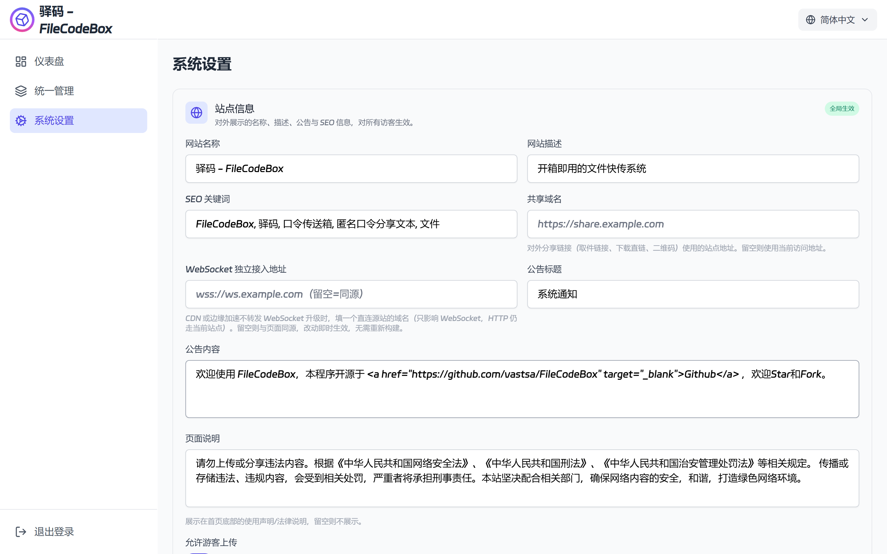
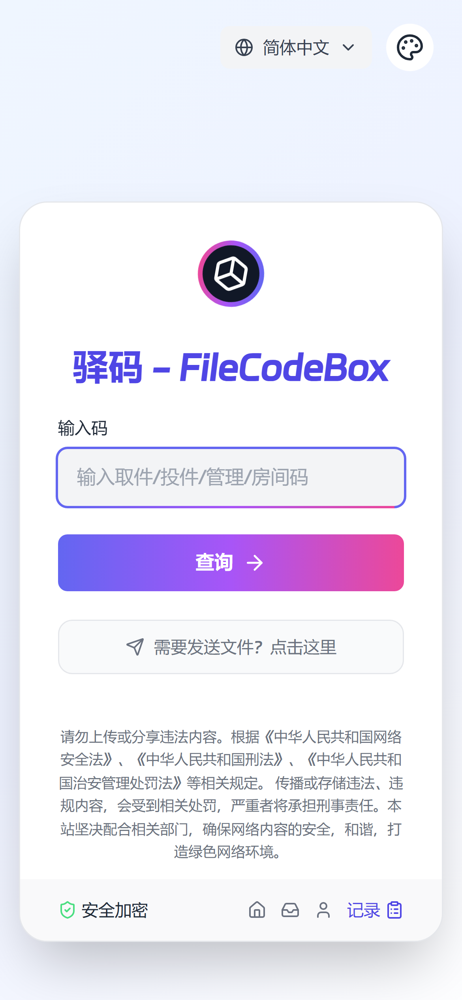

<div align="center">

# FileCodeBox

### Anonymous File & Text Sharing with a Pickup Code

No sign-up. Share and retrieve with a short code.

[](https://github.com/onlypeng/FileCodeBox/stargazers)
[](https://github.com/onlypeng/FileCodeBox/network)
[](https://github.com/onlypeng/FileCodeBox/issues)
[](https://github.com/onlypeng/FileCodeBox/blob/master/LICENSE)

[](https://www.python.org)
[](https://fastapi.tiangolo.com)
[](https://vuejs.org)
[](https://webrtc.org)

[中文](./readme.md) · [Documentation](./docs/en/index.md) · [Contributing](./docs/en/contributing.md) · [Security Policy](./SECURITY.md)

```bash
# One-line deploy (single instance, zero external dependencies)
docker run -d --restart always -p 12345:12345 \
  -v /opt/FileCodeBox:/app/data --name filecodebox \
  onlypeng/filecodebox:latest
```

</div>

---

## Features

| Feature | Description |
|---|---|
| **Pickup code sharing** | Single file / multiple files / plain text; expiry by duration, download count, or never |
| **Second passcode** | An extra passcode on top of the pickup code, delivered over another channel; only its hash is stored, wrong guesses never consume download quota |
| **Collection inbox** | Submitters upload with a delivery code; you collect with a retrieve code and never expose other people's files |
| **Direct transfer** | WebRTC P2P first, server relay as fallback (never written to disk); room cache, screen/camera sharing |
| **Resumable transfer** | Chunked upload and Range download — resume from where it broke |
| **Instant upload & dedup** | Server computes the hash while writing, so identical content is stored once |
| **Pluggable storage** | Local / S3-compatible / OneDrive / WebDAV / OpenDAL, switchable in the admin panel |
| **Admin panel** | Dashboard, file & room management, live config, audit log, TURN connectivity check |
| **Security** | PBKDF2 admin password, JWT, IP failure throttling, encrypted sensitive config, forced first-login password change, virus-scan hook |
| **Interface** | Simplified/Traditional Chinese and English, light & dark themes, mobile ready |

---

## Screenshots

### Retrieve · enter a pickup code



### Send · upload files or just text



### Pickup code · QR and link, one click to copy



### Collection inbox · delivery code separated from retrieve code



### Direct transfer · P2P file exchange and room chat



### Admin panel · dashboard and live configuration





### Mobile



---

## Quick Start

### Docker (recommended)

```bash
docker run -d --restart always -p 12345:12345 \
  -v /opt/FileCodeBox:/app/data \
  -e JWT_SECRET="$(openssl rand -hex 32)" \
  -e ENCRYPTION_KEY="$(openssl rand -hex 32)" \
  --name filecodebox onlypeng/filecodebox:latest
```

If Docker Hub is slow from China, use the mirror `docker.cnb.cool/aixk/filecodebox`.

Open `http://<server-ip>:12345`. The admin panel lives at `/#/admin` with the default password `FileCodeBox2023`, **which you will be forced to change on first login**.

### docker-compose

```yaml
services:
  filecodebox:
    image: onlypeng/filecodebox:latest
    ports: ["12345:12345"]
    volumes: ["./data:/app/data"]
    environment:
      JWT_SECRET: ${JWT_SECRET}
      ENCRYPTION_KEY: ${ENCRYPTION_KEY}
```

### Run from source

```bash
git clone https://github.com/onlypeng/FileCodeBox.git
cd FileCodeBox
python -m venv .venv
.venv/Scripts/python.exe -m pip install -r requirements.txt   # Linux/macOS: source .venv/bin/activate && pip install -r requirements.txt
.venv/Scripts/python.exe main.py
```

A single port serves both the API and the web UI. The prebuilt frontend bundle (`frontend_dist`) is committed, so no extra build step is needed.

---

## Documentation

| Document | Contents |
|---|---|
| [Getting started](./docs/en/guide/getting-started.md) | Deployment, environment variables, reverse proxy, multi-instance prerequisites |
| [Configuration](./docs/en/guide/configuration.md) | Every admin config key and its default |
| [Sharing](./docs/en/guide/share.md) / [Upload](./docs/en/guide/upload.md) | Sharing, expiry, chunked and presigned upload |
| [Collection](./docs/en/guide/collection.md) | The three-code model and delivery flow |
| [Chat & direct transfer](./docs/en/guide/realtime.md) | WebRTC, room cache, deployment notes |
| [Storage](./docs/en/guide/storage.md) | S3 / OneDrive / WebDAV / OpenDAL |
| [Security](./docs/en/guide/security.md) | Password, throttling, whitelist, virus scan |
| [Admin panel](./docs/en/guide/management.md) | What each admin module does |
| [API reference](./docs/en/api/index.md) | Full endpoint reference |
| [Changelog](./docs/en/changelog.md) | Version history |

Stack: Python 3.12 + FastAPI + Tortoise ORM; Vue 3 + Vite + TypeScript. SQLite works out of the box (PostgreSQL / MySQL supported, Redis enables horizontal scaling).

> Continued from [vastsa/FileCodeBox](https://github.com/vastsa/FileCodeBox). Docs and code follow **this repository's implementation**.

---

## Disclaimer

This project is intended for lawful file sharing only. Users must comply with the laws of their jurisdiction and must not use it to distribute illegal or infringing content. The author assumes no responsibility for user actions or their consequences.

Before exposing it to the internet: change the default admin password, set `JWT_SECRET` and `ENCRYPTION_KEY`, enable HTTPS, and configure the file-type whitelist and virus scan as needed.

---

<div align="center">

Based on [vastsa/FileCodeBox](https://github.com/vastsa/FileCodeBox) · License: LGPL-3.0 · see [LICENSE](./LICENSE)

</div>
